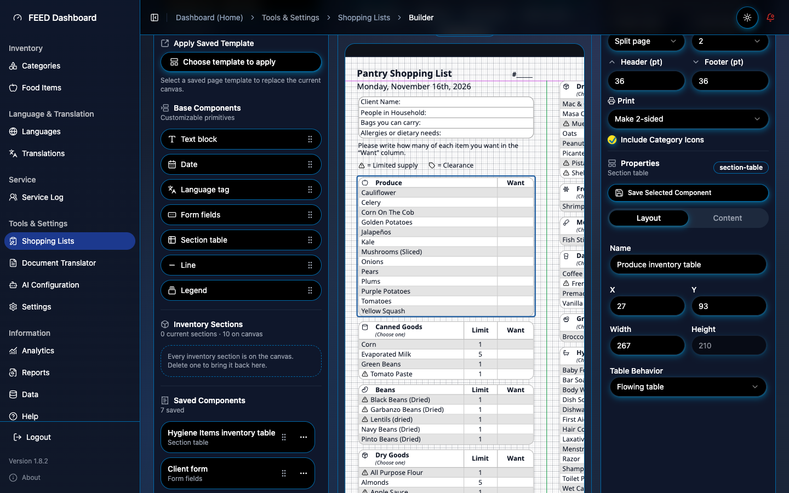
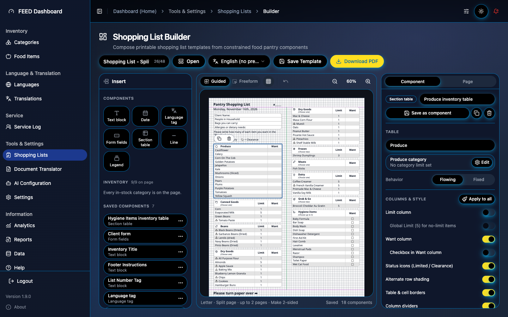
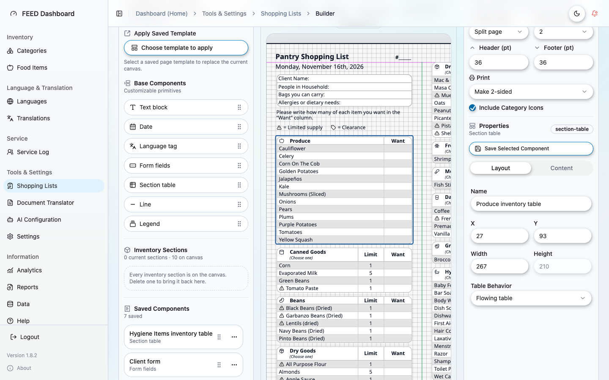
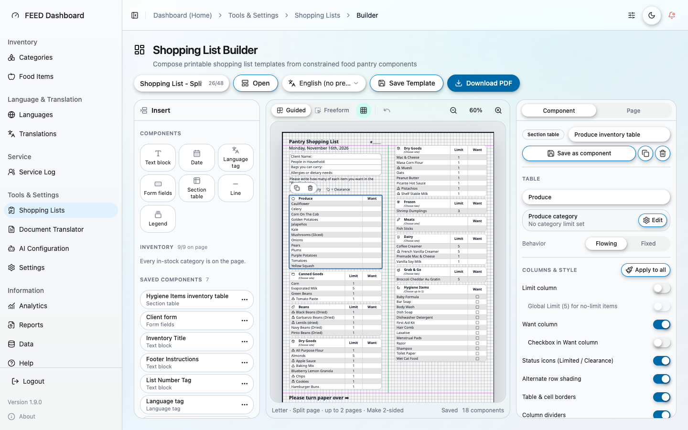
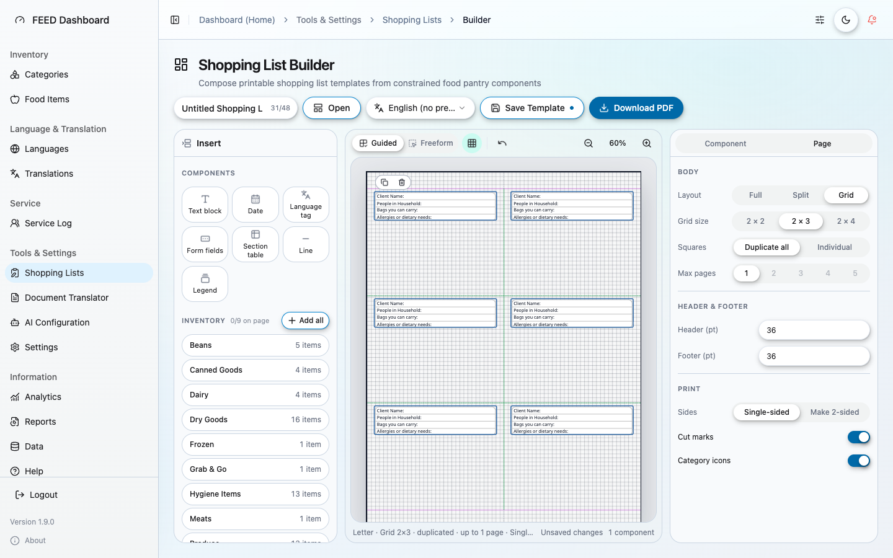

# FEED 1.9.0 — A faster Shopping List Builder, and Grid pages

> **Draft for the GitHub release.** Not published. Frontend and backend read
> 1.9.0; build the Docker images with `VERSION=1.9.0`.

The Shopping List Builder has been reorganised so the same templates take far
fewer steps to build, and it can now lay out a page as a grid of slips.

Nothing about saved templates changes. Every template made in an earlier
version opens and prints as before, with one visible difference noted under
[Upgrade notes](#upgrade-notes).

## Before and after

The same template, with the same table selected.

| Before (1.8.2) | After (1.9.0) |
|---|---|
|  |  |
|  |  |

In 1.8.2 the page scrolled, so the panels moved out of view; a table's
settings were split across two tabs and opened on position fields; and the
zoom control sat at the bottom of the left panel. In 1.9.0 the workspace fits
the window, a table's settings are one scrolling panel in order of use, and
zoom sits on the canvas.

## Fewer steps for the same result

The benchmark is one of the templates staff already use, "Pantry Inventory":
a title, a language tag, a date, ten inventory tables sharing one style, and a
legend. Rebuilt from a blank page, counting each click, drag, or
click-and-type as one action:

| Step | 1.8.2 | 1.9.0 |
|---|---:|---:|
| Name the template, set max pages and header height | 6 | 3 |
| Add the inventory sections | 10 | **1** |
| Give every table the same style | 80 | **9** |
| Set five tables to Fixed | 20 | 10 |
| Title: text, header, bold, centred, 14 pt, not translated, full width | 21 | 12 |
| Language tag | 6 | 5 |
| Date | 12 | 9 |
| Legend in the footer, full width | 6 | 3 |
| Save | 1 | 1 |
| **Total** | **162** | **53** |

**About two thirds fewer actions.** Both columns are counted from the controls
each version requires. Every kind of step in the 1.9.0 column was also
performed in the running app, though not timed with staff.

Where the savings come from:

- **Add all** places every inventory section in one click (10 → 1).
- **Apply to all** copies one table's columns and style to every other table
  (80 → 9).
- **One-click choices** replace two-click dropdowns for bold, alignment, page
  region, table behaviour, body layout, max pages, and print sides.
- **Add, then type.** A new text block opens with the cursor in its text.
- **Keyboard shortcuts**: Delete, Ctrl/⌘ D to duplicate, Ctrl/⌘ Z to undo, Esc
  to deselect, arrow keys to nudge.

## New: Grid pages

A third page layout beside Full and Split. A grid divides the page into
2 × 2, 2 × 3, or 2 × 4 squares, so one Letter sheet prints 4, 6, or 8 slips.

- **Duplicate all** — build one square and every square repeats it.
- **Individual** — each square holds its own content.
- A grid is always one page. **Make 2-sided** prints the same page on the back.
- A square cannot overflow. A change that would not fit is refused, with a
  message naming the component.
- Guided mode stacks items in a square; Freeform places them anywhere inside
  it.

## Also new

- **Cut marks.** Split and Grid pages print dashed cut lines. Turn them off
  under Page → Print.
- **Save state.** Save Template shows a dot when there are unsaved changes.
- **A blank page offers your saved templates**, one click to open.
- **Zoom on the canvas** with Fit width, Fit whole page, and 100%. The page
  opens fitted to the window instead of cropped.
- **Layout column** on the Shopping Lists page.
- **Help** has a rewritten Shopping List Builder guide with new screenshots in
  light and dark.

## Fixed

- The Shopping Lists page showed "Last Updated" as a raw timestamp
  (`2026-06-30T17:16:27.677Z`). It now reads `6/30/2026`.
- Builder palette buttons had no accessible name.
- Deleting a component selected a different one, so a second Delete removed
  something the user had not chosen. The selection now clears.

## Upgrade notes

- **Existing Split templates gain a cut line.** Cut marks are on by default,
  so a Split page now prints a dashed line down the middle of the body. Turn
  off **Cut marks** on a template to restore the old output.
- No database migration. Template data gains optional fields only.
- Grid templates saved in 1.9.0 will not render as grids on an older version.

## Verification

- 605 frontend tests and 151 backend shopping-list tests pass, including 31
  new tests that pin the grid geometry identically on both sides.
- Templates built in the new Builder were exported to PDF, rendered to images,
  and compared with the canvas for Split, both Grid modes, cut marks, and
  two-sided output.
- Checked at 1920 × 1080 and 1280 × 720, in light and dark.
- Not yet done: sessions with Social Services staff. The step counts above are
  measured from the interface, not observed in use.

Design records: [`docs/shopping-lists/builder-ux-rework.md`](../shopping-lists/builder-ux-rework.md),
[`docs/shopping-lists/grid-page-layout.md`](../shopping-lists/grid-page-layout.md).
